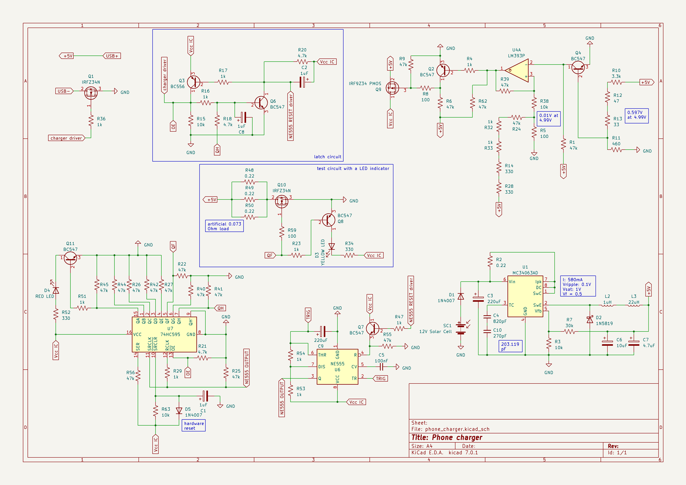

# Solar power supply controller

Using a solar panel as a power supply comes with challenges due to its current-voltage characteristics, particularly the fact that its output voltage may vary depending on the load, irradiance and temperature. Using a solar panel to power devices that expect a stable supply voltage can result in the device repeatedly turning on and off, because while the supply voltage is at the right level before the device starts drawing power, it drops after the load increases. 

This controller basically increases the time between any device's failed attempts to draw power from the solar panel, eliminating the mentioned switching. If the load causes the output voltage to drop below ~5V, the controller stops supplying power and allows the device to try again after ~2s.  
The controller also uses a low resistance test circuit to check whether the voltage would drop with such load. It redirects the power to the device only after the voltage stayed around 5V for ~1s. 

With sufficient irradiance for the given load, the controller operates in the following way: 
1. The solar panel supplies enough voltage for the MC34063 step-down coverter to output 5V. 
2. The rest of the controller's circuitry turns on.
3. NE555 serves as a clock for the 74HC595 shift register by sending pulses to its serial pin.
4. The shift register's output pins go high one by one.
5. The red LED turns on first, indicating the first stage of the countdown.
6. The yellow LED turns on, indicating that the test circuit is on.
7. All the power gets redirected to the USB-A socket.  

At any point, the circuit responsible for turning the controller on in step 2, can reset the whole process if it detects that the voltage dropped too much. 

